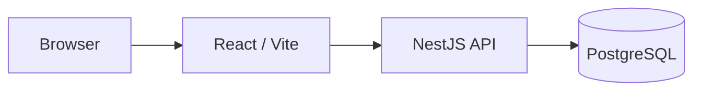

# JobTrack

JobTrack is a full-stack job application tracker built to manage applications, monitor progress through the hiring process, and provide a quick overview of an active job search.

**Live demo:** https://jobtrack-web.onrender.com

## Features

- Create, edit, and delete job applications
- Track application status through the hiring process
- Search applications by company or position
- Filter applications by status
- View detailed information for each application
- Store job posting links, source, location, and notes
- Dashboard with job search statistics
- Responsive layout for desktop and mobile
- Loading, empty, error, and submission states
- Persistent PostgreSQL storage
- Automatic database migrations
- Continuous Integration with GitHub Actions

## Screenshots

### Applications


### Application details


### Dashboard


## Tech Stack

### Frontend

- React
- TypeScript
- Vite
- React Router
- CSS

### Backend

- Node.js
- NestJS
- TypeScript
- TypeORM
- PostgreSQL
- class-validator

### Infrastructure

- Docker
- Docker Compose
- GitHub Actions
- Render
- Neon PostgreSQL

## Architecture



The production application is deployed using:

```text
Browser
   ↓
React frontend on Render
   ↓
NestJS API on Render
   ↓
PostgreSQL on Neon
```

For local development, the API and database can run through Docker while the frontend runs through the Vite development server with hot reload.

## Application Statuses

Applications can move through the following stages:

- Applied
- Screening
- Technical
- Final interview
- Offer
- Rejected

## Project Structure

```text
jobtrack/
├── apps/
│   ├── web/             # React frontend
│   └── api/             # NestJS backend
├── .github/
│   └── workflows/       # CI configuration
└── compose.yaml         # Docker Compose configuration
```

## Running Locally

### Prerequisites

- Node.js 24+
- npm
- Docker Desktop

### Full Docker environment

From the repository root:

```bash
docker compose up -d --build
```

The services will be available at:

```text
Frontend: http://localhost:18080
API:      http://localhost:3000
```

To stop the environment:

```bash
docker compose down
```

## Development Mode

For faster frontend development, run PostgreSQL and the API through Docker:

```bash
docker compose up -d postgres api
```

Then start the Vite development server:

```bash
cd apps/web
npm install
npm run dev
```

The frontend will be available at:

```text
http://localhost:5173
```

Changes to the React application are reflected immediately through Vite hot reload.

## Backend Environment

Create:

```text
apps/api/.env
```

For a local PostgreSQL instance:

```env
DB_HOST=localhost
DB_PORT=5432
DB_USER=jobtrack
DB_PASSWORD=jobtrack
DB_NAME=jobtrack
```

Alternatively, the API supports a PostgreSQL connection URL:

```env
DATABASE_URL=postgresql://...
```

When `DATABASE_URL` is present, it takes precedence over the individual database settings.

The `.env` file is excluded from version control.

## Database Migrations

The project uses TypeORM migrations rather than schema synchronization.

To inspect migration status:

```bash
cd apps/api
npx typeorm-ts-node-esm migration:show -d ./src/data-source.ts
```

To run pending migrations:

```bash
npx typeorm-ts-node-esm migration:run -d ./src/data-source.ts
```

Production containers automatically run pending migrations before starting the API.

## Testing

Backend unit tests use Vitest with mocked TypeORM repositories.

Run the API tests with:

```bash
cd apps/api
npm test
```

Build the API:

```bash
npm run build
```

Build the frontend:

```bash
cd apps/web
npm run build
```

## Continuous Integration

GitHub Actions runs automatically on pushes and pull requests.

The CI pipeline currently verifies:

### API

- Dependency installation
- Unit tests
- Production build

### Web

- Dependency installation
- Production build

This provides an automated check that both applications remain buildable and that backend tests continue to pass.

## API

The application exposes a REST API for job applications.

Main endpoints:

```text
GET    /applications
GET    /applications/:id
POST   /applications
PATCH  /applications/:id
DELETE /applications/:id
```

Requests are validated using NestJS validation pipes and DTOs.

## Deployment

### Frontend

The React application is deployed as a Render Static Site.

https://jobtrack-web.onrender.com

### API

The NestJS application runs as a Docker-based Render Web Service.

https://jobtrack-api-x2di.onrender.com

### Database

Production data is stored in a Neon-hosted PostgreSQL database.

## Engineering Decisions

A few implementation choices were made to keep development and production behavior predictable:

- Database schema changes are managed through migrations rather than TypeORM `synchronize`
- The same backend supports both individual local database settings and a production `DATABASE_URL`
- React API access is isolated from application state management
- The frontend uses a shared applications context for application data and mutations
- API mutations update local state only after the server operation succeeds
- Docker provides a reproducible local environment
- Production database migrations run automatically before the API starts
- Client-side routes use a server rewrite so direct URL navigation and page refreshes work correctly
- CORS configuration is environment-based so local and deployed frontends can both access the API

## Future Ideas

Possible extensions include:

- Application history and status timeline
- Recruiter and professional contact management
- Interview scheduling
- Kanban-style application workflow
- More detailed analytics
- End-to-end testing
